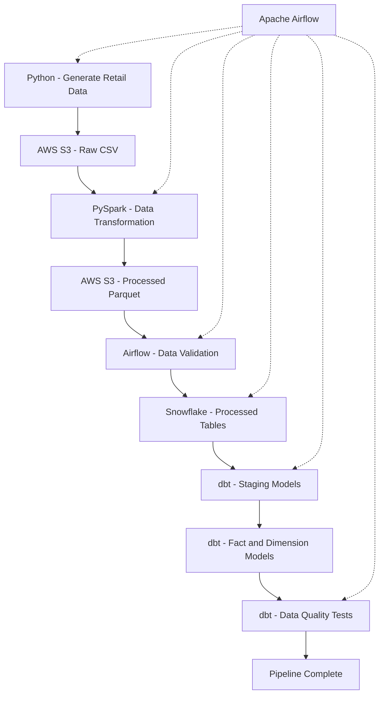

# Retail Data Platform

An end-to-end Data Engineering portfolio project that demonstrates
batch data processing, cloud storage, orchestration, data warehousing,
analytics transformation, data quality testing, and CI/CD.

The platform uses synthetic retail data representing customers,
products, orders, order items, and payments.

## 1. Project Architecture

### Batch Data Pipeline



Apache Airflow orchestrates the batch pipeline, ensuring that
dependent tasks execute in the correct order.

## 2. Technology Stack

| Technology | Purpose |
|---|---|
| Python | Synthetic data generation and ETL scripts |
| PostgreSQL | Relational database and SQL development |
| AWS S3 | Raw and processed data storage |
| PySpark | Distributed data transformation |
| Apache Airflow | Pipeline orchestration and scheduling |
| Snowflake | Cloud data warehousing |
| dbt | SQL transformations and data quality tests |
| Apache Kafka | Event streaming experiments |
| Databricks | Lakehouse processing |
| Delta Lake | Delta tables and data processing |
| Docker | Containerized applications |
| Terraform | Infrastructure-as-code exercises |
| GitHub Actions | Automated CI checks |
| Git and GitHub | Version control and collaboration |

## 3. Batch Pipeline Workflow

### Step 1: Generate Synthetic Data

Python scripts generate retail datasets containing:

- Customers
- Products
- Orders
- Order items
- Payments

The generated datasets are stored locally as CSV files.

### Step 2: Upload Raw Data to AWS S3

Python uploads the generated CSV datasets to the raw storage
layer in AWS S3.

### Step 3: Transform Data Using PySpark

PySpark processes the retail datasets and creates:

- Processed orders
- Customer summary

The transformed datasets are written in Parquet format.

### Step 4: Upload Processed Data to S3

The processed Parquet files are synchronized to the processed
storage layer in AWS S3.

### Step 5: Validate Data

Apache Airflow performs validation checks to confirm that
required raw files and processed Parquet datasets exist in S3.

### Step 6: Load Data into Snowflake

A Python script connects to Snowflake using key-pair
authentication.

The script loads processed Parquet files through a Snowflake
external stage into temporary tables and refreshes the
destination tables using a transaction.

### Step 7: Transform Data Using dbt

dbt builds analytical models from the Snowflake processed data.

The project includes:

- Staging models
- Customer dimension model
- Orders fact model

### Step 8: Run Data Quality Tests

dbt tests check data quality constraints such as:

- Unique identifiers
- Non-null values
- Accepted values
- Relationships between models

Airflow marks the pipeline successful only when all required
tasks, including dbt tests, finish successfully.

## 4. Apache Airflow Orchestration

The primary Airflow DAG is:

`retail_data_pipeline`

DAG source:

`dags/retail_pipeline_dag.py`

The pipeline runs the following tasks:

1. Generate synthetic retail data
2. Upload raw CSV data to S3
3. Run PySpark transformations
4. Upload processed Parquet data to S3
5. Validate S3 datasets
6. Load Snowflake tables
7. Execute dbt models
8. Execute dbt tests
9. Mark the pipeline complete

The DAG includes task dependencies, retries, and failure handling.

**Project status:** The complete batch pipeline has been executed
successfully with all Airflow tasks passing.

## 5. Kafka Streaming and Databricks

In addition to the batch pipeline, this repository includes
separate streaming and lakehouse experiments.

### Apache Kafka

A Python Kafka producer generates retail order events.

A Dockerized producer can publish events to the Kafka topic:

`retail_orders`

### Databricks and Delta Lake

The Databricks experiments process retail data into Delta tables,
including:

- `orders_raw`
- `orders_clean`
- `orders_rejected`
- `daily_order_summary`

These experiments demonstrate streaming concepts, data cleaning,
validation, and Delta Lake processing.

**Note:** The Kafka and Databricks workflows are separate from
the primary Airflow batch DAG.

## 6. Docker

Docker is used to containerize parts of the project.

The repository includes Docker configuration for:

- Synthetic customer data generation
- Kafka order event producer

Docker Compose is used to manage the containerized components.

## 7. Terraform

Terraform is used for infrastructure-as-code learning and
configuration validation.

The Terraform exercises include:

- AWS provider configuration
- Terraform variables
- Existing S3 bucket references
- IAM policy data
- Terraform plan and apply workflows

The current Terraform exercises are not intended to provision
the entire production infrastructure.

## 8. CI/CD with GitHub Actions

GitHub Actions automatically performs checks for repository changes.

The CI workflow includes:

- Python syntax validation
- Python unit tests
- Terraform formatting and validation
- Docker image builds

Workflow configuration:

`.github/workflows/ci.yml`

The project uses automated CI checks to identify code and
configuration issues before further development.

## 9. Repository Structure

```text
retail-data-platform/
|
|-- .github/
|   |-- workflows/
|       |-- ci.yml
|
|-- dags/
|   |-- retail_pipeline_dag.py
|
|-- python/
|   |-- load_snowflake.py
|   |-- retail_spark_pipeline.py
|   |-- kafka_order_producer.py
|   |-- other ETL and generation scripts
|
|-- retail_dbt/
|   |-- dbt project and SQL models
|
|-- terraform/
|   |-- Terraform configuration files
|
|-- data/
|   |-- Generated local datasets
|
|-- Dockerfile
|-- Dockerfile.kafka
|-- compose.yaml
|-- README.md
```

## 10. Running the Batch Pipeline

### Prerequisites

A local development environment with:

- Python
- Apache Airflow
- PySpark
- AWS CLI
- Snowflake access
- dbt

The current DAG uses local virtual environments and a
machine-specific project path. These paths must be configured
for the machine running Airflow.

### Authentication

Before running the pipeline:

1. Authenticate with AWS using an authorized AWS CLI session.
2. Ensure the Snowflake service account has the required grants.
3. Make the encrypted Snowflake private-key passphrase available
   securely to the Airflow process.

Do not commit passwords, private keys, access tokens, or other
credentials to GitHub.

### Start Airflow

From the project directory, activate the Airflow environment:

```bash
source .airflow-venv/bin/activate
```

Start Airflow:

```bash
export AIRFLOW__CORE__DAGS_FOLDER="$PWD/dags"
airflow standalone
```

Open the Airflow dashboard:

http://localhost:8080

Find `retail_data_pipeline` and trigger the DAG manually.

Monitor the task statuses and logs in the Airflow interface.

**Note:** Running the pipeline writes data to AWS S3 and
Snowflake and may consume cloud resources. The S3 publishing
process is not fully atomic and would need further hardening
for production use.

## 11. Key Data Engineering Concepts

This project demonstrates:

- ETL and ELT pipelines
- SQL and relational databases
- Data lake storage
- Parquet file formats
- Distributed processing with Spark
- Workflow orchestration with Airflow
- Cloud data warehousing with Snowflake
- Data modeling with dbt
- Fact and dimension tables
- Automated data quality checks
- Kafka event streaming
- Delta Lake processing
- Docker containerization
- Infrastructure as Code
- CI/CD automation
- Secure key-pair authentication

## 12. Future Improvements

Potential next steps include:

- Incremental data loading and processing
- Stronger data quality and reconciliation checks
- Atomic or versioned S3 dataset publishing
- Centralized secrets management
- Pipeline monitoring and alerting
- Environment-specific deployment configuration
- Automated infrastructure deployment
- Improved pipeline observability

## 13. Project Purpose

This project was developed as a hands-on Data Engineering
portfolio project to demonstrate how multiple technologies
work together to build, orchestrate, transform, validate,
and serve data for analytics.
