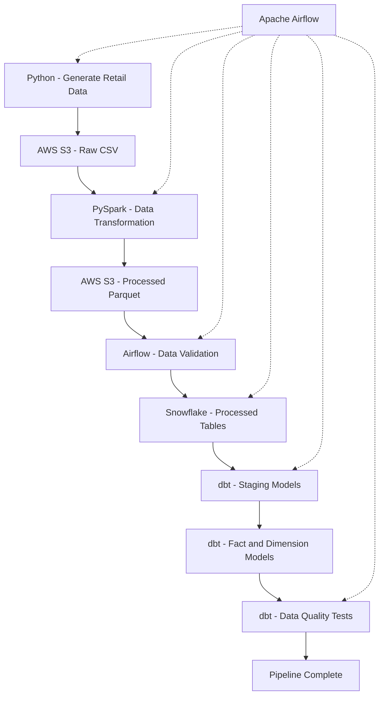

# Retail Data Platform

An end-to-end Data Engineering portfolio project that demonstrates
batch data processing, cloud storage, orchestration, data warehousing,
analytics transformation, data quality testing, and CI/CD.

The platform uses synthetic retail data representing customers,
products, orders, order items, and payments.

## 1. Project Architecture

### Batch Data Pipeline



Apache Airflow orchestrates the batch pipeline, ensuring that
dependent tasks execute in the correct order.

## 2. Technology Stack

| Technology | Purpose |
|---|---|
| Python | Synthetic data generation and ETL scripts |
| PostgreSQL | Relational database and SQL development |
| AWS S3 | Raw and processed data storage |
| PySpark | Distributed data transformation |
| Apache Airflow | Pipeline orchestration and scheduling |
| Snowflake | Cloud data warehousing |
| dbt | SQL transformations and data quality tests |
| Apache Kafka | Event streaming experiments |
| Databricks | Lakehouse processing |
| Delta Lake | Delta tables and data processing |
| Docker | Containerized applications |
| Terraform | Infrastructure-as-code exercises |
| GitHub Actions | Automated CI checks |
| Git and GitHub | Version control and collaboration |

## 3. Batch Pipeline Workflow

### Step 1: Generate Synthetic Data

Python scripts generate retail datasets containing:

- Customers
- Products
- Orders
- Order items
- Payments

The generated datasets are stored locally as CSV files.

### Step 2: Upload Raw Data to AWS S3

Python uploads the generated CSV datasets to the raw storage
layer in AWS S3.

### Step 3: Transform Data Using PySpark

PySpark processes the retail datasets and creates:

- Processed orders
- Customer summary

The transformed datasets are written in Parquet format.

### Step 4: Upload Processed Data to S3

The processed Parquet files are synchronized to the processed
storage layer in AWS S3.

### Step 5: Validate Data

Apache Airflow performs validation checks to confirm that
required raw files and processed Parquet datasets exist in S3.

### Step 6: Load Data into Snowflake

A Python script connects to Snowflake using key-pair
authentication.

The script loads processed Parquet files through a Snowflake
external stage into temporary tables and refreshes the
destination tables using a transaction.

### Step 7: Transform Data Using dbt

dbt builds analytical models from the Snowflake processed data.

The project includes:

- Staging models
- Customer dimension model
- Orders fact model

### Step 8: Run Data Quality Tests

dbt tests check data quality constraints such as:

- Unique identifiers
- Non-null values
- Accepted values
- Relationships between models

Airflow marks the pipeline successful only when all required
tasks, including dbt tests, finish successfully.

## 4. Apache Airflow Orchestration

The primary Airflow DAG is:

`retail_data_pipeline`

DAG source:

`dags/retail_pipeline_dag.py`

The pipeline runs the following tasks:

1. Generate synthetic retail data
2. Upload raw CSV data to S3
3. Run PySpark transformations
4. Upload processed Parquet data to S3
5. Validate S3 datasets
6. Load Snowflake tables
7. Execute dbt models
8. Execute dbt tests
9. Mark the pipeline complete

The DAG includes task dependencies, retries, and failure handling.

**Validation status (2026-10-19):** Local DAG imports, mocked task/loader tests,
offline dbt parsing, Terraform validation, and a local synthetic Spark batch
passed during the repository audit. A live end-to-end cloud run was not repeated.

## 5. Kafka Streaming and Databricks

In addition to the batch pipeline, this repository includes
separate streaming and lakehouse experiments.

### Apache Kafka

A Python Kafka producer generates retail order events.

A Dockerized producer can publish events to the Kafka topic:

`retail_orders`

### Databricks and Delta Lake

The Databricks experiments process retail data into Delta tables,
including:

- `orders_raw`
- `orders_clean`
- `orders_rejected`
- `daily_order_summary`

These experiments demonstrate streaming concepts, data cleaning,
validation, and Delta Lake processing.

**Note:** The Kafka and Databricks workflows are separate from
the primary Airflow batch DAG.

## 6. Docker

Docker is used to containerize parts of the project.

The repository includes Docker configuration for:

- Synthetic customer data generation
- Kafka order event producer

Docker Compose is used to manage the containerized components.

## 7. Terraform

Terraform is used for infrastructure-as-code learning and
configuration validation.

The Terraform exercises include:

- AWS provider configuration
- Terraform variables
- Existing S3 bucket references
- IAM policy data
- Terraform plan and apply workflows

The current Terraform exercises are not intended to provision
the entire production infrastructure.

## 8. CI/CD with GitHub Actions

GitHub Actions automatically performs checks for repository changes.

The CI workflow includes:

- Python syntax checks, focused Ruff correctness linting, and offline unit tests
- Airflow DAG imports, dependency graph checks, and mocked task failure checks
- Offline dbt parsing with a nonfunctional test profile
- Terraform formatting, backend-free initialization, and validation
- Compose validation, Docker image builds, and a customer-generator smoke test

Workflow configuration:

`.github/workflows/ci.yml`

The project uses automated CI checks to identify code and
configuration issues before further development.

## 9. Repository Structure

```text
retail-data-platform/
|
|-- .github/
|   |-- workflows/
|       |-- ci.yml
|
|-- dags/
|   |-- retail_pipeline_dag.py
|
|-- python/
|   |-- load_snowflake.py
|   |-- retail_spark_pipeline.py
|   |-- kafka_order_producer.py
|   |-- other ETL and generation scripts
|
|-- retail_dbt/
|   |-- dbt project and SQL models
|
|-- terraform/
|   |-- Terraform configuration files
|
|-- data/
|   |-- Generated local datasets
|
|-- Dockerfile
|-- Dockerfile.kafka
|-- compose.yaml
|-- README.md
```

## 10. Running the Batch Pipeline

### Prerequisites

A local development environment with:

- Python
- Apache Airflow
- PySpark
- AWS CLI
- Snowflake access
- dbt

Use Python 3.11 for the tested environments and Java 17 for the local Spark
batch. Keep Spark, Airflow, and dbt in separate virtual environments:

```bash
python3.11 -m venv .venv
.venv/bin/python -m pip install -r requirements.txt
python3.11 -m venv .airflow-venv
.airflow-venv/bin/python -m pip install -r requirements-airflow.txt
python3.11 -m venv .dbt-venv
.dbt-venv/bin/python -m pip install -r requirements-dbt.txt
```

The DAG defaults to the repository containing its source file and the three
environments above. For a different worker layout, set these in every Airflow
worker's environment before it imports the DAG:

| Variable | Default / purpose |
|---|---|
| `RETAIL_PROJECT_ROOT` | Parent of `dags/`; override with an absolute repository path for bundled DAG deployments |
| `RETAIL_PROJECT_PYTHON` | `<root>/.venv/bin/python` |
| `RETAIL_SNOWFLAKE_PYTHON` | `<root>/.airflow-venv/bin/python` |
| `RETAIL_DBT_EXECUTABLE` | `<root>/.dbt-venv/bin/dbt` |
| `RETAIL_BUCKET` | Required by the S3 tasks (no default); name of an existing, authorized bucket |
| `RETAIL_SEED` | Optional; any integer makes the data generators produce the same data every run |
| `DBT_PROFILES_DIR` | dbt's usual profile search location; use a private directory |

Use absolute executable paths for overrides. `aws` must be on each worker's
`PATH`. The DAG serializes its own runs with `max_active_runs=1` because its
files and cloud destinations are shared; this does not coordinate other DAGs,
manual scripts, or deployments.

### Authentication

Before running the pipeline:

1. Authenticate with AWS using an authorized AWS CLI session.
2. Ensure the Snowflake service account has the required grants.
3. Make the encrypted Snowflake private-key passphrase available
   securely to the Airflow process as `SNOWFLAKE_KEY_PASSPHRASE`.
4. Set `SNOWFLAKE_ACCOUNT` (required, no default). You can also
   override `SNOWFLAKE_USER`, `SNOWFLAKE_ROLE`,
   `SNOWFLAKE_WAREHOUSE`, and `SNOWFLAKE_PRIVATE_KEY_FILE` (default
   `~/.dbt/snowflake_dbt_key.p8`). The loader and source models still target
   `RETAIL_DB.PROCESSED`; a bucket override does not repoint the Snowflake stage.
5. Use `retail_dbt/profiles.example.yml` to configure a real private dbt profile,
   or retain your existing working profile. Both tools must refer to the same
   Snowflake account and data. Inject secrets through your secure environment.

Snowflake prerequisites are external to this repository: warehouse and role
grants, database/schema, `ORDERS` and `CUSTOMER_SUMMARY` destination tables,
`RETAIL_DB.PROCESSED.RETAIL_PROCESSED_STAGE` pointing at the selected bucket's
`processed/` prefix, and `RETAIL_DB.PROCESSED.PARQUET_FORMAT`. Validate their
schemas and grants before a live run; the audit did not inspect those objects.

Do not commit passwords, private keys, access tokens, or other
credentials to GitHub.

### Start Airflow

From the project directory, activate the Airflow environment:

```bash
source .airflow-venv/bin/activate
```

Start Airflow:

```bash
export AIRFLOW__CORE__DAGS_FOLDER="$PWD/dags"
airflow standalone
```

Open the Airflow dashboard:

http://localhost:8080

Find `retail_data_pipeline` and trigger the DAG manually.

Monitor the task statuses and logs in the Airflow interface.

**Cloud effects:** Triggering this DAG overwrites the raw S3 CSV keys, uploads
processed Parquet, and then uses `aws s3 sync --delete` to remove stale Parquet
objects from the two processed dataset prefixes. It replaces both Snowflake
destination tables' rows in a transaction and builds dbt models. These are live
writes and can consume paid resources. The S3 publish is not atomic; use an
isolated development bucket/stage for a separately authorized live test.
The audit executed none of these cloud operations.

### Local checks without cloud execution

Install test dependencies in a separate test environment or in your Airflow
development environment (do not combine Airflow and dbt dependencies):

```bash
.airflow-venv/bin/python -m pip install -r requirements-dev.txt
.airflow-venv/bin/python -m pytest -v
.airflow-venv/bin/ruff check --select E9,F63,F7,F82 python dags scripts tests
AIRFLOW_HOME="$PWD/airflow-audit" AIRFLOW__CORE__UNIT_TEST_MODE=True \
  .airflow-venv/bin/python scripts/check_dags.py
DBT_SEND_ANONYMOUS_USAGE_STATS=false .dbt-venv/bin/dbt parse \
  --project-dir retail_dbt --profiles-dir tests/fixtures/dbt --no-partial-parse
terraform -chdir=terraform fmt -check
terraform -chdir=terraform init -backend=false -input=false -lockfile=readonly
terraform -chdir=terraform validate
docker compose config --quiet
```

`pytest` discovers only `tests/`; the Spark/Delta demo scripts under `python/`
are standalone programs that start services or write outputs. DAG tests skip
without Airflow; Snowflake loader tests skip without the connector. Spark transform
tests skip without PySpark. `dbt parse` checks structure and references,
not SQL execution or actual data tests. Terraform init may download providers;
these validation commands do not run a plan or apply.

After intentionally updating a provider version, record checksums for both the
Linux CI runner and Apple Silicon development machines before committing:

```bash
terraform -chdir=terraform providers lock -platform=linux_amd64 -platform=darwin_arm64
```

This verifies packages from their origin and records platform hashes. Commit
the reviewed `.terraform.lock.hcl` change; CI keeps its lockfile read-only.


With Docker running, `docker compose run --rm customer-generator` writes only
local synthetic output. `docker compose up` also starts the producer and sends
Kafka events, so it is not an offline validation command.

`sql/01_create_tables.sql` bootstraps fresh PostgreSQL tables, including the
`customer_etl.py` destination. It is not a Snowflake schema setup script.

## 11. Key Data Engineering Concepts

This project demonstrates:

- ETL and ELT pipelines
- SQL and relational databases
- Data lake storage
- Parquet file formats
- Distributed processing with Spark
- Workflow orchestration with Airflow
- Cloud data warehousing with Snowflake
- Data modeling with dbt
- Fact and dimension tables
- Automated data quality checks
- Kafka event streaming
- Delta Lake processing
- Docker containerization
- Infrastructure as Code
- CI/CD automation
- Secure key-pair authentication

## 12. Future Improvements

Potential next steps include:

- Incremental data loading and processing
- Stronger data quality and reconciliation checks
- Atomic or versioned S3 dataset publishing
- Centralized secrets management
- Pipeline monitoring and alerting
- Environment-specific deployment configuration
- Automated infrastructure deployment
- Improved pipeline observability

## 13. Project Purpose

This project was developed as a hands-on Data Engineering
portfolio project to demonstrate how multiple technologies
work together to build, orchestrate, transform, validate,
and serve data for analytics.
